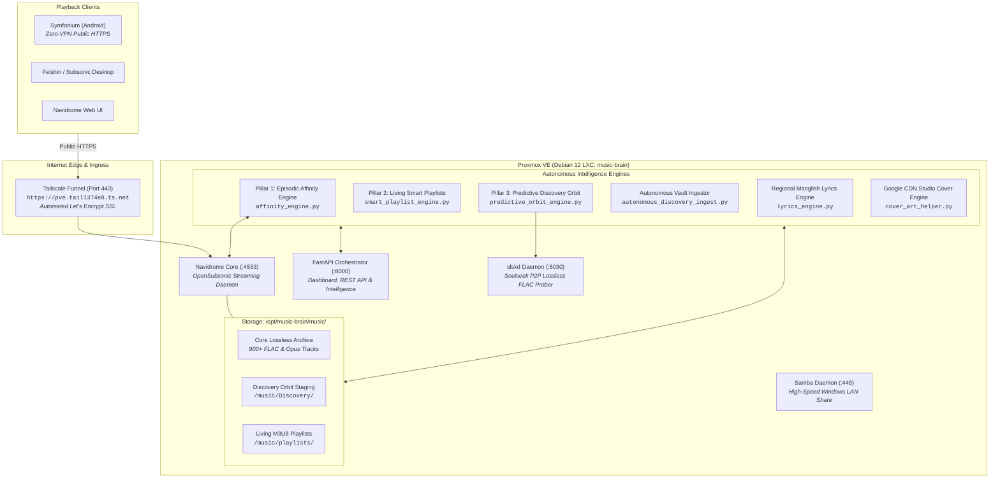
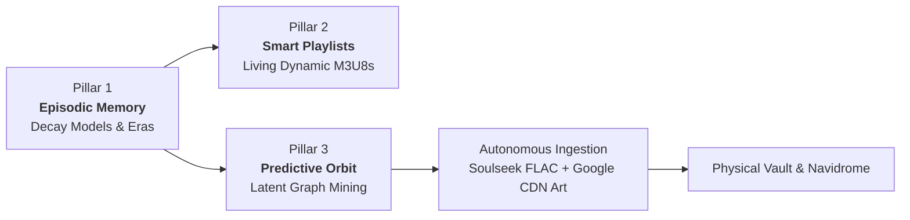

# Lossless Vault 🎵
### Autonomous Personal Music Intelligence System & Lossless Audio Vault

[](https://proxmox.com)
[](https://python.org)
[](https://fastapi.tiangolo.com)
[](https://www.navidrome.org)
[-blueviolet)](https://github.com/slskd/slskd)
[](LICENSE)

An intelligent, self-evolving, self-hosted music server ecosystem. **Lossless Vault** bridges the gap between private local media storage and modern algorithmic streaming, combining mathematical episodic memory, autonomous discovery ingestion, Google CDN 1200×1200 studio artwork, phonetic regional lyrics (Manglish/Tanglish), and zero-VPN mobile streaming.

---

## 🏛️ System Architecture



---

## 🧠 The Three Pillars of Music Intelligence



### Pillar 1: Episodic Memory & Affinity Engine
Traditional streaming algorithms rely on opaque black-box recommendations that blur together your past and present. Lossless Vault models human musical memory using explicit mathematical decay:

* **Short-Term Obsession ($A_{\text{short}}$):** 45-day half-life exponential decay modeling current repeat obsessions:
  $$A_{\text{short}}(t) = \sum_{i} \exp\left(-\frac{\ln(2)}{45} \cdot (t - t_i)\right)$$
* **Long-Term Affinity ($A_{\text{long}}$):** 365-day half-life decay modeling foundational taste:
  $$A_{\text{long}}(t) = \sum_{i} \exp\left(-\frac{\ln(2)}{365} \cdot (t - t_i)\right)$$
* **72-Hour Velocity ($\Delta A / \Delta t$):** Detects breakout tracks surging in frequency over the last 3 days to seed discovery.
* **Historical Changepoint Clustering:** Analyzes 1,950+ historical events (2021–2026) to segment your listening journey into distinct eras:
  1. *The Genesis Era (2021)*
  2. *Vault Expansion Era (2022)*
  3. *Acoustic & Indie Interlude (2023–2024)*
  4. *Regional Renaissance (2025)*
  5. *The Modern Golden Era (2026)*
* **Circadian Flow:** Tracks listening time-of-day across 4 circadian slots (*Morning Focus, Afternoon Groove, Evening Unwind, Late Night Drift*).

---

### Pillar 2: Autonomous Smart Playlists
Compiles 6 living, auto-regenerating `.m3u8` playlists in Navidrome:

| Playlist | Tracks | Selection Algorithm |
| :--- | :--- | :--- |
| **`Heavy Rotation`** | 35 | Highest active $A_{\text{short}}$ affinity score. |
| **`Forgotten Gems`** | 35 | High all-time affinity tracks with 0 plays in $>45$ days. |
| **`Time Machine`** | 35 | Historical repeats from matching calendar months in past years (2021–2025). |
| **`Circadian Flow`** | 30 | Dynamically tuned to the active hour of the day. |
| **`Deep Vault`** | 30 | Lesser-played B-sides from your top 5 favorite artists. |
| **`The Bridge`** | 17 | Universal gateway tracks that maintain high affinity across multiple listening eras. |

---

### Pillar 3: Predictive Discovery, Lossless Orbit & Autonomous Ingestion
Instead of leaving recommendations as static links on a web page, Lossless Vault **physically downloads, tags, and serves them**:

1. **Velocity Seeding:** Takes tracks with the highest 72-hour velocity ($\Delta A / \Delta t$).
2. **InnerTube Recommendation Graph:** Traverses YouTube Music's high-dimensional acoustic graph (`get_watch_playlist`).
3. **Fuzzy Levenshtein Deduplication:** Filters against 900+ vault tracks by ID and normalized string similarity ($\ge 0.82$ dropped).
4. **Soulseek P2P Lossless Probing:** Queries local `slskd` daemon (port 5030) for peer-shared FLACs with duration matching within $\pm 3.0\text{s}$ tolerance.
5. **Autonomous Ingestion (`autonomous_discovery_ingest.py`):**
   * Downloads high-bitrate Opus (`format 251`) into `/music/Discovery/<Artist>/<Album>/`.
   * Embeds official 1200×1200 Google CDN studio artwork into Vorbis picture blocks.
   * Auto-compiles **`Discovery Orbit.m3u8`** and triggers Navidrome rescan.

---

## 🎨 Studio Cover Art & Metadata Engine

* **1200×1200 Studio Covers:** Bypasses lossy video thumbnails, pulling official uncompressed studio covers directly from Google's Image CDN (`=w1200-h1200-l90-rj`).
* **Album Splitting Fix:** Standardizes `albumartist` tags across multi-artist collaborations, resolving fragmented album cards.
* **Vorbis Tag Embedding:** All Opus and FLAC tracks contain self-contained cover art, genres, and accurate AcoustID/MusicBrainz recording IDs.

---

## ✍️ Regional Lyrics & Transliteration Engine (Manglish / Tanglish)

For regional Indian music (Malayalam, Tamil, Hindi), standard translations (*"Even in the darkest night..."*) destroy the poetic rhythm and make singing along impossible.

Lossless Vault features a dedicated **Phonetic Dravidian Transliterator**:
* **100% Phonetic Romanization:** Original Malayalam and Tamil lyrics written in the English alphabet (Manglish / Tanglish) — **0% English translation**:
  * *Input (Malayalam script):* `ഏതു കരിരാവിലും ഒരു ചെറു കസവിഴ തുന്നും കിരണമേ...`
  * *Output (Manglish):* `ethu kariraavilum oru cheru kasavizha thunnum kiraname...`
* **Dual Storage:** Embedded in `LYRICS` / `UNSYNCEDLYRICS` Vorbis comments and saved as sidecar `.lrc` files for real-time scrolling in Symfonium.

---

## 🌐 Zero-VPN Remote Streaming (Tailscale Funnel)

* **No VPN Required on Phone:** Bypasses Android's 1-VPN limit, preventing conflicts with ad-blockers and eliminating mobile battery drain.
* **Public HTTPS:** Exposed securely via **Tailscale Funnel** on standard port 443 with automated Let's Encrypt SSL:
  ```text
  https://pve.tail1374e8.ts.net/
  ```
* **Client Compatibility:** Stream instantly with Subsonic clients (Symfonium, Feishin, Substreamer) or any web browser on 5G/Wi-Fi worldwide.

---

## 🚀 Installation & Setup

### Prerequisites
* Proxmox VE (or any Linux server running Debian 12 / Ubuntu 24.04).
* Navidrome installed and running.
* Tailscale (optional, for zero-VPN public Funnel).

### Deployment
```bash
git clone https://github.com/Ihsan01i/Lossless-Vault.git /opt/lossless-vault
cd /opt/lossless-vault

# Run automated installer
chmod +x setup.sh
./setup.sh
```

### Configuration
1. Edit `config/navidrome.toml`: Point `MusicFolder` to your storage directory.
2. Edit `config/slskd.yml`: (Optional) Add your Soulseek credentials for lossless FLAC upgrading.
3. Start the orchestrator service:
   ```bash
   sudo systemctl enable --now music-brain.service
   ```

---

## 📊 REST API Specifications

The FastAPI orchestrator exposes real-time endpoints at `http://localhost:8000`:

| Endpoint | Method | Description |
| :--- | :--- | :--- |
| `/api/intelligence/summary` | `GET` | Active era, top obsessions, surging velocities, circadian slot. |
| `/api/intelligence/affinities` | `GET` | Paginated track and artist affinity table with decay scores. |
| `/api/intelligence/eras` | `GET` | Historical listening eras and bridge gateway tracks. |
| `/api/playlists/smart` | `GET` | Status and track counts of living `.m3u8` smart playlists. |
| `/api/playlists/regenerate`| `POST`| Triggers instant regeneration of all smart playlists. |
| `/api/intelligence/orbit` | `GET` | Current candidate tracks waiting in the predictive orbit. |
| `/api/intelligence/orbit/refresh` | `POST`| Mines new InnerTube seeds and refreshes orbit recommendations. |
| `/api/intelligence/orbit/ingest` | `POST`| Autonomously downloads orbit candidates directly into Navidrome. |

---

## 📜 License
Distributed under the MIT License. Built for private homelab preservation and autonomous music intelligence.
